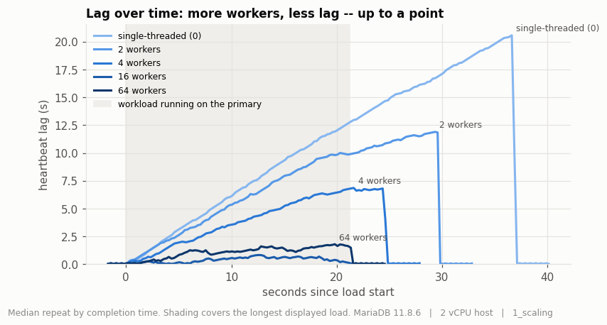

A project for area 14, "Parallel replication and replication lag" for the [MariaDB student database projects, 2026-09](https://mariadb.org/bachelor_hackathon_2026-09/).

# Parallel replication and replication lag in MariaDB

**Author:** Adilbek Taizhanov · BSc Computer Science · Constructor University Bremen · November 2026  
[GitHub repository](https://github.com/The-Creator16/mariadb-parallel-replication-lab) · [Illustrated tutorial (PDF)](docs/tutorial/tutorial.pdf) · [Full results](results/SUMMARY.md)

I wanted to see what happens when a replica has to replay writes from 32 clients through one SQL thread. In the first experiment, the median peak heartbeat age was 19.9 s with serial apply, 22.4 s with one worker and 0.7 s with 16 optimistic workers. Introducing eight shared counters reversed the benefit in a separate live test. On a one-CPU replica draining a fixed backlog, the median apply rate reached 2,715 tx/s at 32 workers and fell to 2,604 at 64. On this machine, adding workers beyond 32 gave no further gain in that test.



## Recorded experiments

Each row compares medians from three interleaved repeats per configuration. The recordings use MariaDB 11.8.6 on a two-vCPU host with a one-CPU quota per benchmark server unless the experiment changes it.

| Experiment | What changed | Result on this host |
|---|---|---|
| [1. Live scaling](results/1_scaling/) | 0–64 workers, 48,000 workload transactions | Four workers reduced median peak lag to 7.0 s. Sixteen reached 0.7 s (range 0.5–0.8 s). |
| [2. Apply capacity](results/2_capacity/) | Worker count and replica CPU quota, with a queued backlog | At 16 workers, raising the quota from one to two CPUs raised replay from 2,682 to 3,721 tx/s. At 64 it rose from 2,604 to 4,281. |
| [3. Scheduling modes](results/3_modes/) | Independent writes or eight shared counters, with a queued backlog | On shared counters, serial apply reached 1,520 tx/s, optimistic 1,118, aggressive 1,619 and conservative 2,208. Conservative with a longer group-commit window reached 2,247, with overlapping ranges. |
| [4. Workload](results/4_workloads/) | Serial apply vs 16 optimistic workers | Peak lag fell from 14.1 to 0.4 s for independent accounts and rose from 8.5 to 13.8 s on shared counters. For per-client tables it fell from 8.5 to 0.4 s with InnoDB and rose from 9.4 to 14.1 s with MyISAM. |
| [5. DDL](results/5_ddl/) | Rebuild a separate table in the DML domain or in domain 1 | With 16 workers, moving the ALTER to domain 1 reduced peak domain-0 heartbeat age from 8.1 to 5.1 s. With serial apply the peaks were 24.1 and 23.2 s. |
| [6. Durability](results/6_durability/) | Change replica sync_binlog and innodb_flush_log_at_trx_commit together | With serial apply the relaxed settings raised throughput from 1,474 to 3,596 tx/s. At 16 workers the medians were 2,634 and 2,511 tx/s for durable and relaxed settings. |

## Data model and lab setup

The lab generates its own data in MariaDB. Before each timed run, the harness recreates the workload tables on the primary with the Sequence storage engine and waits for the replica to catch up. The initial account balances and row counts are fixed. Clients choose accounts at random within their assigned ranges. The table definitions are in [reset.sql](sql/reset.sql) and the workload procedures in [labctl.sql](sql/labctl.sql).

| Table | Why it is in the experiment |
|---|---|
| `lab.accounts` and `lab.ledger` | Start with 200,000 accounts at a balance of 1,000. Each independent transaction updates four account rows and appends four ledger entries. Clients own disjoint account IDs, while the ledger adds the cost of maintaining secondary indexes. |
| `lab.hot_counters` | The hotspot workload adds one update to a counter chosen from eight shared rows. Clients can now contend for the same row while doing the same account and ledger work. |
| `lab.own_innodb_*` and `lab.own_myisam_*` | Each client inserts into its own table. The same insert pattern isolates the change of storage engine. InnoDB can roll back speculative work on a conflict. MyISAM cannot. |
| `lab.archive` | The DDL experiment populates two million rows and rebuilds the table with `ALTER TABLE ... ALGORITHM=COPY`. Account writers use separate tables, which makes it possible to test the ALTER in an independent GTID domain. |
| `labctl.heartbeat` | A single timestamped row travels through the same domain as the account updates. Its age on the replica gives a lag measurement in seconds. |

Docker Compose runs a MariaDB primary and a replica with row-based logging and GTID replication. An optional third server runs the delayed-recovery demo. The Python harness launches one stored-procedure call per client on the primary and samples the replica every 250 ms. Six [experiment plans](experiments/) define the workloads and settings. Each configuration runs three times, interleaved with the others.

## Rebuild the analysis

The repository includes samples, metadata, binlog group counts and summaries for all 150 runs. Python 3.10+ and Matplotlib are sufficient to rebuild the analysis. The requirements also install PyMySQL for live runs.

```sh
git clone --branch main https://github.com/The-Creator16/mariadb-parallel-replication-lab
cd mariadb-parallel-replication-lab
python3 -m venv .venv
. .venv/bin/activate
pip install -r requirements.txt
python -m lab summarize results/[1-6]_*
make plots report
```

## Run the lab

For live runs, install Docker with the Compose plugin and GNU Make, then activate the Python environment from the previous section. The recorded experiments used MariaDB 11.8.6. Copy the example settings before starting them to use the reference CPU quotas. The default image tag tracks the 11.8 series. The exact server build used for the recordings is listed in each run's meta.json.

```sh
cp .env.example .env
make up setup smoke
make status
python -m lab run --threads 16 --workload hotspot --hot 8
```

Use a disposable lab instance. `make setup` configures replication and installs the control schema. The two smoke runs generate and load their own data, then plot the comparison in `results/smoke/lag.png`. For a fresh measurement of all six plans, keep the recorded results and write to a separate directory:

```sh
export LAB_RESULTS_DIR="$PWD/results-local"
make experiments plots report
```

The plan command resumes completed configurations by default. Use a fresh output directory when changing a plan. Run the delayed demo separately from timing experiments. The demo creates, drops and restores shop.customers on the lab servers.

```sh
unset LAB_RESULTS_DIR
make demo-binlog
make up-delayed setup demo-delayed
make down
```

## Reading the measurements

The heartbeat is updated on the primary every 100 ms in domain 0. Its age on the replica measures freshness in that domain. A GTID backlog also counts changes in other domains, including events the IO thread may still have to fetch. The harness reads positions sequentially, so a busy server can advance between queries.

Live runs measure both arrival and replay rates. Catch-up runs pause the SQL thread while clients write, then restart it to drain the queue. The heartbeat continues after the workload finishes. Binlog counters measure transactions per commit group. Physical disk flushes and CPU utilisation were not instrumented.

The [method](docs/method.md) defines the metrics and sampling windows. The [SQL walkthrough](docs/walkthrough.md) runs the same workloads by hand. The [replication notes](docs/concepts.md) explain the scheduling modes. The delayed-recovery and checksum demos include their original [recovery transcript](results/demo_delayed/output.txt) and [binlog transcript](results/demo_binlog/output.txt).
